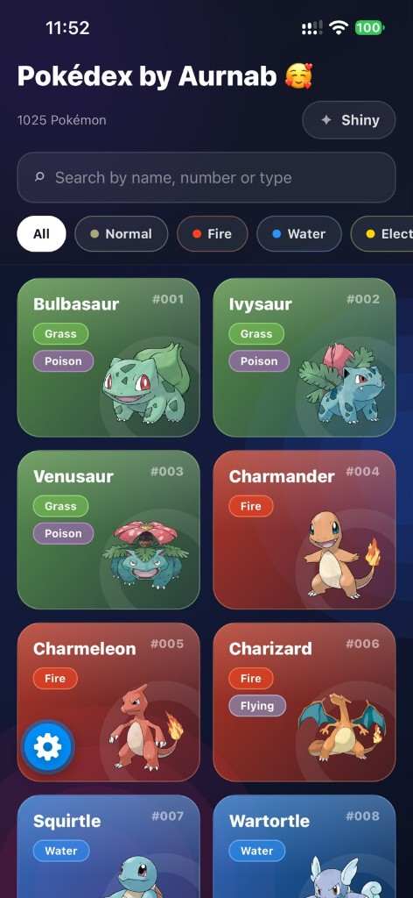
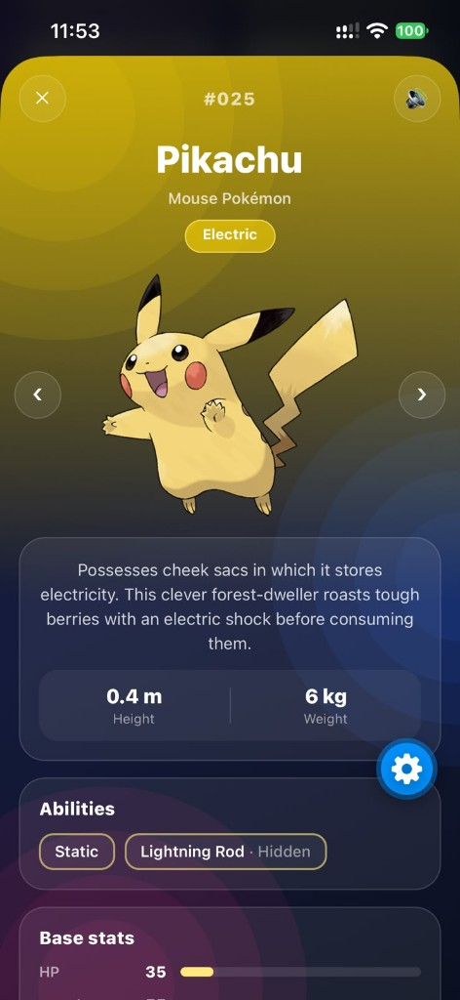

# Pokédex by Aurnab 🥰

A glassmorphism Pokédex for Android, iOS and web, built with **Expo (SDK 57)**, **Expo Router** and **TypeScript**. Browse all **1,025 Pokémon**, search and filter by type, flip on Shiny Mode, and open any Pokémon to see its stats, abilities, evolution chain and cry.

Data comes from the free [PokéAPI](https://pokeapi.co/), so no API key or backend is required.

## Screenshots

<p align="center">
  
  &nbsp;&nbsp;&nbsp;
  
</p>

<p align="center"><em>Home screen (left) · Details screen (right)</em></p>

## Features

- **All 1,025 Pokémon** with infinite scroll (loads 24 at a time)
- **Live search** by name, number (`25`, `#025`) or type
- **Type filter chips**: All, Fire, Water, Grass, Electric, and the rest
- **Type-based colors**: every card is tinted with its main type's color
- **Shiny Mode ✨**: switches every sprite to its shiny version, with sparkle effects
- **Details screen** with official artwork, description, height and weight, abilities, animated base stats and a tappable evolution chain
- **Pokémon cries 🔊** played on demand from the details screen
- **Glassmorphism UI** with a frosted-glass header, translucent cards and a dark gradient background

## Tech stack

| Area | Library |
| --- | --- |
| Framework | [Expo SDK 57](https://docs.expo.dev/) + React Native |
| Navigation | [Expo Router](https://docs.expo.dev/router/introduction/) (file-based routing) |
| Images | `expo-image` |
| Audio | `expo-audio` |
| UI effects | `expo-blur`, `expo-linear-gradient`, `react-native-reanimated` |
| Language | TypeScript (strict) |
| Data | [PokéAPI](https://pokeapi.co/) |

---

## Run it on your computer (step by step)

### 1. Install the prerequisites

| Tool | Why you need it | Download |
| --- | --- | --- |
| **Node.js** (LTS, v20 or newer) | Runs the dev server | [nodejs.org](https://nodejs.org/) |
| **Git** | Downloads the project | [git-scm.com](https://git-scm.com/downloads) |
| **Expo Go** app on your phone | Runs the app on your phone without building it | [Android](https://play.google.com/store/apps/details?id=host.exp.exponent) · [iOS](https://apps.apple.com/app/expo-go/id982107779) |

Check that Node and Git are installed:

```bash
node -v
git --version
```

> **Note:** This project uses **Expo SDK 57**. If Expo Go says the project is incompatible, your Expo Go app supports a different SDK version. See [Troubleshooting](#troubleshooting).

### 2. Download the project

```bash
git clone https://github.com/Zubayer-Aurnab/pokedex.git
cd pokedex
```

Or click **Code → Download ZIP** on GitHub, unzip it, and open a terminal inside the unzipped folder.

### 3. Install dependencies

```bash
npm install
```

This takes a minute or two the first time.

### 4. Start the development server

```bash
npx expo start
```

A **QR code** and a menu will appear in your terminal.

### 5. Open the app

Pick whichever option suits you:

- **On your phone (easiest):** make sure your phone and computer are on the **same Wi-Fi network**.
  - **Android:** open **Expo Go** and tap **Scan QR code**.
  - **iPhone:** open the **Camera** app and scan the QR code, then tap the banner to open it in Expo Go.
- **Android emulator:** press `a` in the terminal. Requires [Android Studio](https://docs.expo.dev/workflow/android-studio-emulator/).
- **iOS simulator (macOS only):** press `i` in the terminal. Requires [Xcode](https://docs.expo.dev/workflow/ios-simulator/).
- **Web browser:** press `w` in the terminal.

The first load downloads the Pokémon list, so give it a few seconds. 🎉

### Useful terminal shortcuts (while `npx expo start` is running)

| Key | Action |
| --- | --- |
| `r` | Reload the app |
| `m` | Open the developer menu |
| `j` | Open the debugger |
| `Ctrl + C` | Stop the server |

---

## Troubleshooting

**The QR code doesn't connect / app keeps loading**
Your phone and computer must be on the same network. If they are and it still fails (for example on office or university Wi-Fi), use tunnel mode:

```bash
npx expo start --tunnel
```

**"Project is incompatible with this version of Expo Go"**
The Expo Go app supports one SDK version at a time. Either install the Expo Go version that matches **SDK 57** (see [expo.dev/go](https://expo.dev/go)), or use an Android emulator or iOS simulator, where Expo installs the matching Expo Go for you.

**Red error screen or strange cache errors after pulling new changes**
Clear the cache and restart:

```bash
npx expo start -c
```

**`npm install` fails**
Make sure you're on Node.js LTS (`node -v`), delete `node_modules` and `package-lock.json`, then run `npm install` again.

---

## Build an installable app (optional)

The project is configured for [EAS Build](https://docs.expo.dev/build/introduction/) (see `eas.json`). You need a free [Expo account](https://expo.dev/signup).

```bash
# Log in
npx eas-cli@latest login

# Android: installable .apk
npx eas-cli@latest build --platform android --profile preview

# iOS: .ipa for registered devices (requires a paid Apple Developer account)
npx eas-cli@latest device:create
npx eas-cli@latest build --platform ios --profile preview

# iOS Simulator build (no Apple account needed, runs on a Mac only)
npx eas-cli@latest build --platform ios --profile preview-simulator
```

When a build finishes, EAS gives you a download link and QR code to install it.

---

## Project structure

```
src/
├── app/                    # Screens (Expo Router)
│   ├── _layout.tsx         # Root stack, theme, Shiny Mode provider
│   ├── index.tsx           # Home: search, type filters, Pokémon grid
│   └── pokemon/[id].tsx    # Details screen (opens as a modal)
├── components/             # Cards, search bar, filters, stat bars, evolution chain…
├── constants/typeColors.ts # Colors for each Pokémon type
├── context/shiny-mode.tsx  # Global Shiny Mode state
├── lib/
│   ├── pokemon.ts          # PokéAPI requests, caching, helpers
│   └── cries.ts            # Pokémon cry playback
└── types/pokemon.ts        # TypeScript types for app data and API responses
```

## Scripts

| Command | Description |
| --- | --- |
| `npm start` | Start the Expo dev server |
| `npm run android` | Start and open on Android |
| `npm run ios` | Start and open on iOS (macOS only) |
| `npm run web` | Start and open in the browser |
| `npm run lint` | Lint the project |
| `npx tsc --noEmit` | Type-check the project |

## Credits

- Pokémon data and sprites: [PokéAPI](https://pokeapi.co/)
- Pokémon cries: [PokéAPI Cries](https://github.com/PokeAPI/cries) and [Pokémon Showdown](https://play.pokemonshowdown.com/)
- Pokémon and Pokémon character names are trademarks of Nintendo, Game Freak and The Pokémon Company. This is a fan project for learning purposes.

---

Made with ❤️ by **Aurnab**
